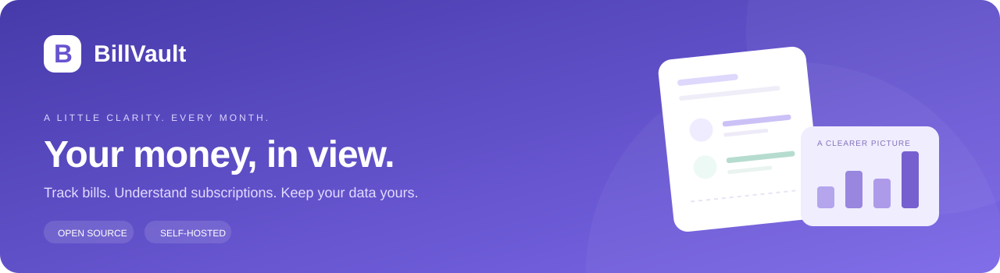
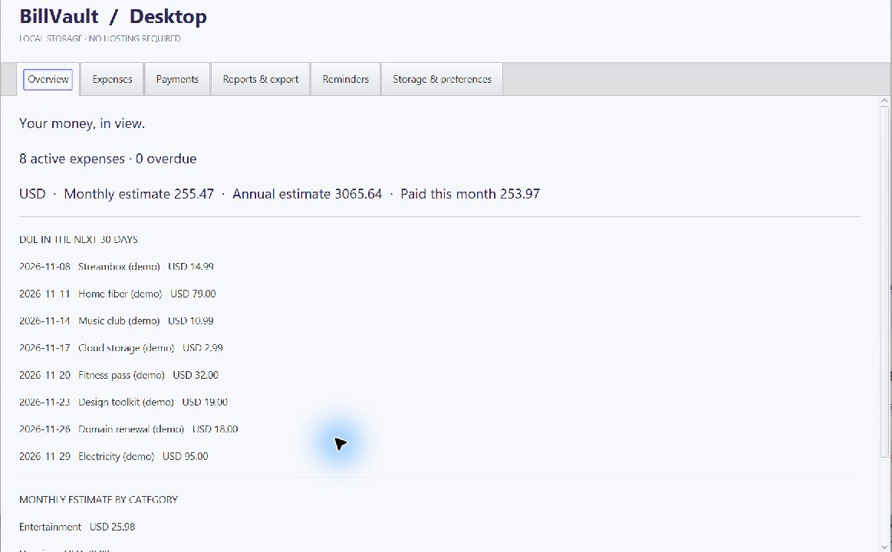
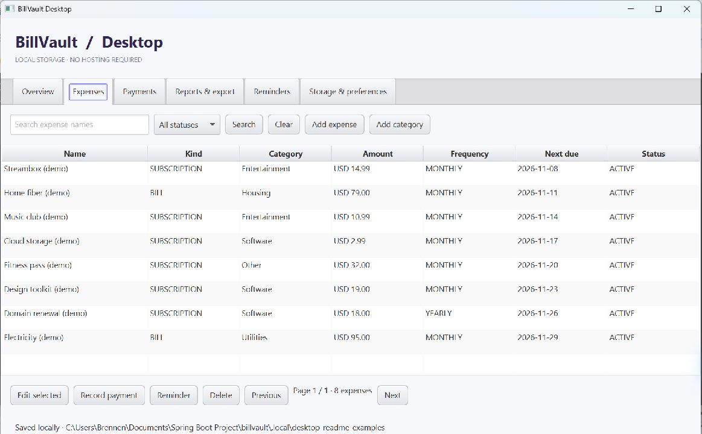
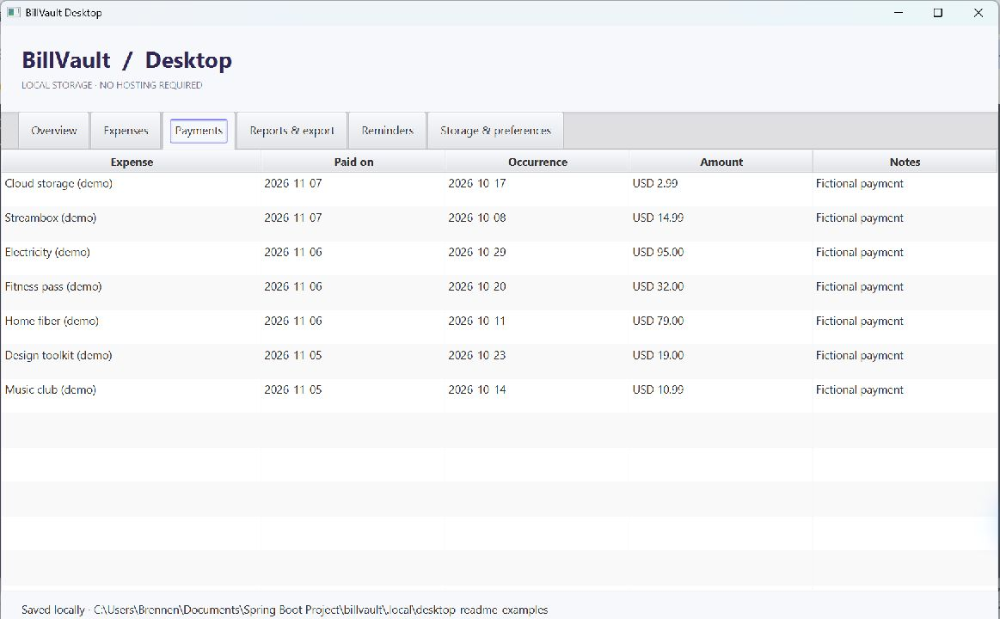
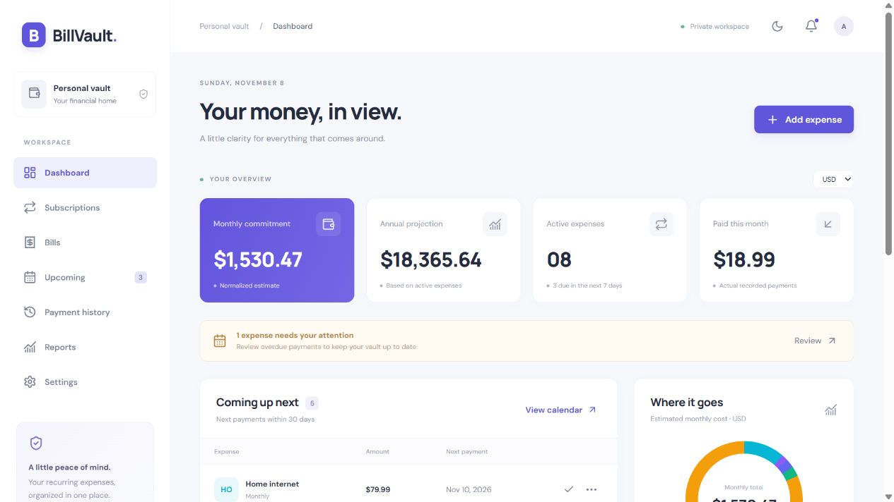
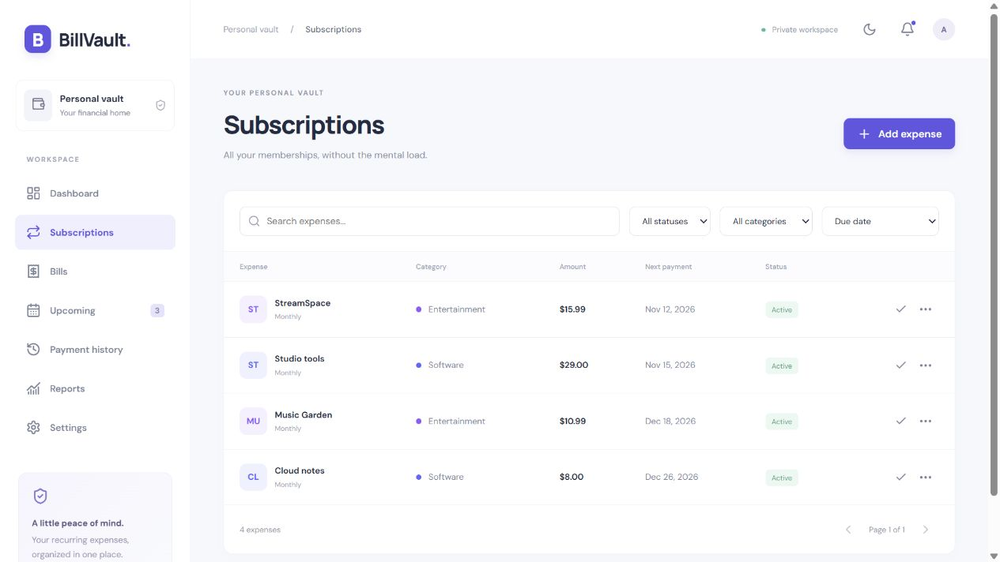
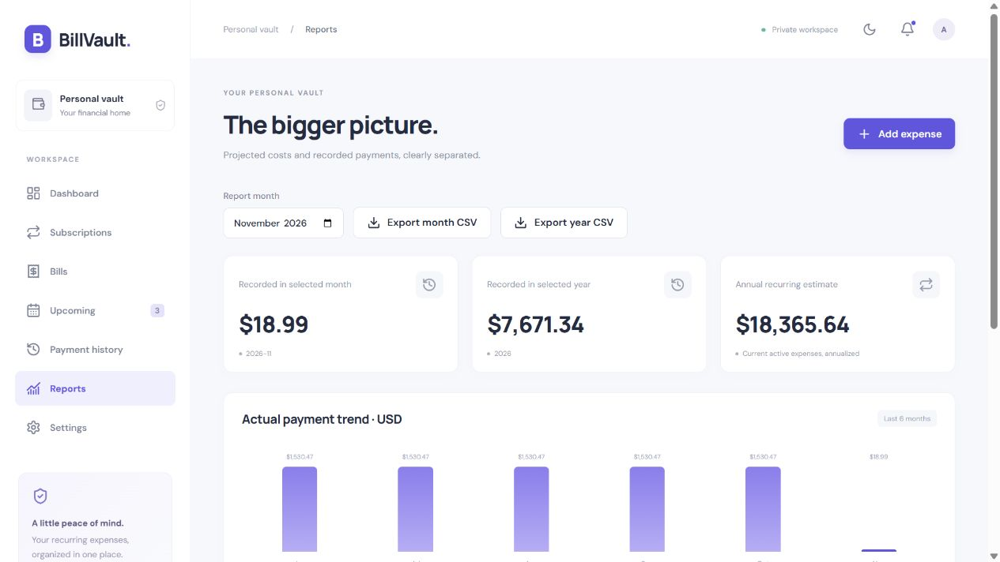
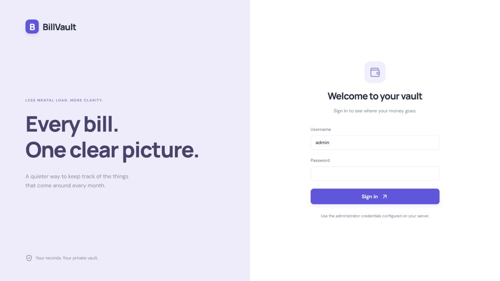

<p align="center"></p>

<p align="center"><a href="LICENSE">MIT License</a> · Java 25 · Spring Boot 4.1 · React 19 · TypeScript · JavaFX</p>

<p align="center"><strong>Your bills and subscriptions, on your terms.</strong><br>Understand recurring costs, record payments, and keep your financial records on your own machine.</p>
<p align="center"><a href="#standalone-desktop-app">Download desktop</a> · <a href="#self-host-the-web-app">Self-host the web app</a> · <a href="#standalone-app-screenshots">Desktop screenshots</a> · <a href="#web-app-screenshots">Web screenshots</a> · <a href="CONTRIBUTING.md">Contribute</a></p>

## Choose how you want to use BillVault

**Download the standalone app for your computer, or self-host the web app and use it in your browser.**

| | Standalone desktop app | Self-hosted web app |
| --- | --- | --- |
| Best for | Downloading and opening a local application | Running your own browser-based installation |
| Interface | Native JavaFX window | React web interface |
| Setup | Windows EXE / ZIP or Linux AppImage; Java included | Docker Compose, or build and run the Java server |
| Hosting | None | You run the web app on your computer or server |
| Access | Your operating-system account; no app login | Administrator sign-in in your browser |
| Storage | Embedded local H2 database | PostgreSQL with Docker, or local H2 |
| Get started | **[Download the desktop app](#standalone-desktop-app)** | **[Self-host the web app](#self-host-the-web-app)** |

Both editions keep you in control of your records. They use **separate databases** and do not automatically sync.
The desktop edition is an initial preview with its own interface; see the [desktop guide](desktop/README.md) for its features and limits.

## Why BillVault?

Recurring expenses are easy to forget and hard to see together. BillVault brings household bills and subscriptions
into one dashboard, with a clear distinction between **what you expect to spend** and **what you actually paid**.
It never connects to a bank or moves money.

BillVault is a bills and subscription management application by [Brennen Griffith](https://github.com/BrennenGriffith).
It is MIT-licensed, open to contributions, and under active development for personal use.
The web edition has one administrator; it is not an audited financial service or a multi-user SaaS platform.

## Standalone app screenshots

The **native JavaFX desktop app**, captured from the Windows standalone package. These examples use a separate
fictional vault with eight expenses and seven payments; downloads start with an empty vault.



| Manage local expenses | Review recorded payments |
| --- | --- |
|  |  |

### Desktop example: track a subscription

1. Open the desktop app and choose **Expenses → Add expense**.
2. Enter `Streambox (demo)`, choose **SUBSCRIPTION**, **Entertainment**, `14.99` **USD**, and **MONTHLY**.
   Set the start date and first due date, then save.
3. Select it and choose **Record payment**. Confirm the amount and payment date. The payment appears under
   **Payments**, and the next due date advances by one occurrence.
4. Open **Reports & export**, select a date and choose **Show totals**. To export the ledger, choose a date range
   and **Export CSV**. The overview's monthly estimate remains distinct from actual payments.

For a variable bill such as `Electricity (demo)`, keep an estimate on the expense and enter the actual amount
when recording each payment. See the [desktop examples](desktop/README.md#example-workflows) for more.

## Web app screenshots

These screenshots show the **self-hosted React web app**. The standalone desktop app uses native JavaFX controls.

**All screenshots use fictional expenses in an isolated demo database. No personal financial records are shown.**



| Manage subscriptions | Understand your spending |
| --- | --- |
|  |  |

<details><summary>See the private sign-in screen</summary>



</details>

## Web app features

The web edition includes the features below. For the standalone edition, see [desktop features](desktop/README.md#what-it-includes).

- **One expense model:** bills and subscriptions, categories, status, notes, website, and payment labels.
- **Practical recurrence:** weekly, monthly, quarterly, yearly and custom intervals; month-end/leap-year handling.
- **Reliable payment history:** actual amounts, variable bills, duplicate occurrence protection, and automatic next-date advancement.
- **Useful overview:** monthly/annual estimates, upcoming and overdue bills, category breakdowns, and actual payment trends.
- **Reports and exports:** monthly/yearly payment summaries, projected calendar, and CSV downloads.
- **In-app reminders:** configurable lead times, read/unread state, and hourly checks.
- **Private local access:** BCrypt password hashing, server sessions, CSRF protection, and loopback-only personal startup.
- **Built for ownership:** persistent storage, versioned Flyway migrations, light/dark themes, backup tools, and no analytics.
- **Safer edits:** stale versions return a conflict rather than overwriting another tab's changes.

## Standalone desktop app

Prefer a native application? **[BillVault Desktop downloads](https://github.com/BrennenGriffith/billvault/releases)**
are published separately from the web edition. The JavaFX client runs locally with an embedded database;
no hosting, Docker, browser, or separately installed Java is needed for packaged downloads.

| Platform | Desktop 0.1.0 preview download |
| --- | --- |
| Windows x64 | [Installer EXE](https://github.com/BrennenGriffith/billvault/releases/download/desktop-v0.1.0/BillVaultDesktop-0.1.0.exe) · [Portable ZIP](https://github.com/BrennenGriffith/billvault/releases/download/desktop-v0.1.0/BillVaultDesktop-0.1.0-windows-x64.zip) |
| Linux x86_64 | [AppImage](https://github.com/BrennenGriffith/billvault/releases/download/desktop-v0.1.0/BillVaultDesktop-0.1.0-x86_64.AppImage) |

Both include a Java runtime; SHA256 files accompany the downloads in Releases. See the **[desktop guide](desktop/README.md)**
for installation, data locations, backup instructions, source builds, and platform limitations.
The desktop database is separate from the web database; there is no automatic synchronization.
Desktop access uses your operating-system account, with no application password or saved administrator credential.
Windows packages are unsigned. This is an initial preview release; back up your records before upgrades.

**Start using it:**

1. Download the package for your operating system from the table above.
2. On Windows, run the installer, or extract the entire portable ZIP and open `BillVaultDesktop.exe`.
3. On Linux, make the AppImage executable with `chmod +x BillVaultDesktop-0.1.0-x86_64.AppImage`, then open it.

Your records are saved in your OS user-data folder. You do not need to clone this repository or start a server.

<a id="self-host-it"></a>

## Self-host the web app

Choose this edition to use BillVault in a browser. You run the React frontend and Spring Boot backend yourself;
Docker Compose also manages PostgreSQL. The supplied configurations bind to your own computer by default.
For a container installation, go straight to the **[Docker tutorial](docs/DOCKER.md)**.

The options below all run the **web edition**, including the Windows option without Docker.

### Web option A — Run locally on Windows without Docker

You need **JDK 25** and **Node.js 24** for the initial build. Only Java is needed to run the built application each day.
Git and PowerShell are used by these instructions.

```powershell
git clone https://github.com/BrennenGriffith/billvault.git
cd billvault
.\scripts\build.ps1
.\scripts\start-personal.ps1
```

Each startup prompts for an administrator password without saving a credential file. The username defaults to `admin`.
Open **http://127.0.0.1:8080**. React and the REST API are served together from one executable JAR.
For future starts, run only `scripts/start-personal.ps1`. Stop with Ctrl+C before backups or upgrades.
If a development backend already uses port 8080, stop it first; do not run two processes against the same database.

Records live in `data/billvault.mv.db`, a persistent H2 database. The personal profile reuses the original local data path.
The password is supplied to Java in memory; the shell environment is restored on exit. Fonts are included in the application;
the running app does not load Google Fonts. OpenAPI is disabled in personal mode.

**Read the [local operations guide](docs/LOCAL_OPERATIONS.md) for password changes, updates, backups, and restore checks.**
H2 is the small single-user local option. PostgreSQL is available through Compose and is the intended cloud database.

### Web option B — Docker Compose with PostgreSQL

You need Docker Engine/Desktop with Compose. This is suitable for Windows, Linux, or a home server.

```powershell
git clone https://github.com/BrennenGriffith/billvault.git
cd billvault
.\scripts\start-docker.ps1
```

Follow the **[Docker tutorial](docs/DOCKER.md)** for installation, Linux/macOS commands, credentials, updates, and backups.
The helper writes no credential file. Docker retains environment values in local container metadata; see the tutorial.
Open **http://127.0.0.1:8088**. The frontend reverse proxy is published on loopback; the backend and PostgreSQL stay internal.
PostgreSQL persists in a named volume. `docker compose down` stops services without removing that volume.
Do not use `down -v` for a real installation unless you intentionally want to erase its database.

For development against Docker PostgreSQL, use the loopback-only database override in `compose.dev.yaml`.
See [database setup and backups](docs/DATABASE.md). H2 files cannot be restored directly into PostgreSQL;
a complete H2-to-PostgreSQL data migration tool is not implemented yet.

### Web option C — A built JAR on Linux/macOS

Build the frontend and Java application, then supply an administrator password through your environment:

```sh
cd frontend
npm ci
npm test
npm run build
cd ..
./mvnw verify
# Set ADMIN_USERNAME and ADMIN_PASSWORD securely in your environment.
java -Xms128m -Xmx512m -jar target/billvault-0.0.1-SNAPSHOT.jar --spring.profiles.active=personal
```

This uses local H2 and loopback HTTP. Protect the data directory with your operating system's file permissions.
Keep passwords out of shell history and source files. Supply the password again when the application restarts.

### Internet hosting later

The supplied configurations are for private local use. A future AWS deployment needs HTTPS, Secure cookies,
protected secrets, automated off-host backups, and login abuse protection. Containers and PostgreSQL keep that path
straightforward, but **there is no Terraform deployment or paid cloud provisioning in this repository yet**.
Publishing the source on GitHub does not publish your running vault or database.

## Back up your records

**Desktop app:** close it and back up its database using the [desktop backup guide](desktop/README.md#back-up-restore-and-update).
The instructions below are for the **web edition**.

For the Windows/H2 personal installation, stop the application and run:

```powershell
.\scripts\backup-local.ps1
.\scripts\restore-check.ps1 -BackupFile 'C:/path/to/your-backup.mv.db'
```

Backups default to `%LOCALAPPDATA%/BillVault/backups`, outside the repository. Checksums verify file integrity;
restore checks create a separate copy and never overwrite your live database. Inspect that copy in the app before
relying on a backup. Copy backups to another device for protection from disk failure.
For PostgreSQL, use the [pg_dump and restore instructions](docs/DATABASE.md).

## Develop and contribute

Run the API and Vite with live reload in separate terminals:

```powershell
.\scripts\start-local.ps1
.\scripts\start-frontend.ps1
```

Open http://127.0.0.1:5173. Vite proxies API requests to the backend on port 8080.
Spring Boot does not automatically read `.env`; Docker Compose does. Host-run processes use shell environment variables.
The personal script prompts on each start and does not save credentials.

Verification:

```powershell
npm.cmd --prefix frontend ci
npm.cmd --prefix frontend test
npm.cmd --prefix frontend run build
.\mvnw.cmd verify
```

Backend tests use an isolated H2 database by default. Set TEST_DB_URL, TEST_DB_USER and TEST_DB_PASSWORD for a
**dedicated disposable PostgreSQL test database**. Never point tests at your personal financial records.
An [opt-in GitHub Actions workflow](docs/ci/README.md) is included for frontend checks, Java verification,
PostgreSQL integration tests and a Compose smoke test. It is supplied as a template and is not active until
you install it under `.github/workflows/`. No application is deployed by that workflow.

Read [CONTRIBUTING.md](CONTRIBUTING.md), open a focused [issue](https://github.com/BrennenGriffith/billvault/issues),
or submit a pull request. Documentation, accessibility improvements, edge-case tests and query optimizations are welcome.
Report security concerns privately according to [SECURITY.md](SECURITY.md).

## Architecture

```text
React + TypeScript
        │ same-origin /api
Spring Security → Controller → Service → Repository → H2 / PostgreSQL
                                  │
                           BillingCalculator
```

Java 25 · Spring Boot 4.1 · Spring Data JPA · Flyway · PostgreSQL/H2 · React 19 · TypeScript · Vite.
The personal JAR serves the frontend itself; Docker uses nginx. DTO records separate API contracts from JPA entities.
Money is calculated in BigDecimal; currencies are reported separately rather than added together.

| Reference | What it explains |
| --- | --- |
| [Architecture](docs/ARCHITECTURE.md) | Components and request flow |
| [API](docs/API.md) | Endpoints, DTOs and status codes |
| [Docker tutorial](docs/DOCKER.md) | Install, start, update, troubleshoot and back up containers |
| [Database](docs/DATABASE.md) | Schema, migrations and PostgreSQL backups |
| [Local operations](docs/LOCAL_OPERATIONS.md) | Daily use, updates, password changes and recovery |
| [Decisions](docs/DECISIONS.md) | Billing rules and technical tradeoffs |
| [Implementation status](docs/IMPLEMENTATION_PLAN.md) | Verified work and remaining limits |

## Current limits and roadmap

**Android is planned, not released.** See the [Android app and launch plan](docs/ANDROID_PLAN.md):
a free app with local storage, optional development support, and a staged Google Play release.
The existing downloads above are for Windows/Linux desktop use.

- One administrator; no multi-user ownership isolation or password-recovery service.
- In-memory sessions reset on restart; reminder scheduling targets one backend instance.
- Deleting an expense deletes its payment history. Cancel it to keep the records.
- Large datasets need payment-history pagination and dedicated database aggregate queries.
- No email delivery, bank connections, exchange-rate conversion, H2-to-PostgreSQL import, or AWS deployment.
- Future work: local operational improvements, broader workflow tests, then optional Terraform-based hosting when funded.

## License

[MIT](LICENSE) — use, modify, self-host, and contribute. Third-party packages and fonts retain their [own licenses](THIRD_PARTY_NOTICES.md). See the license for its terms and warranty disclaimer.
