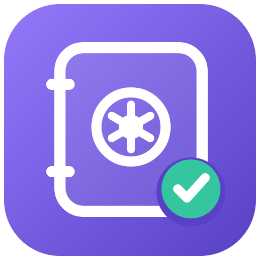
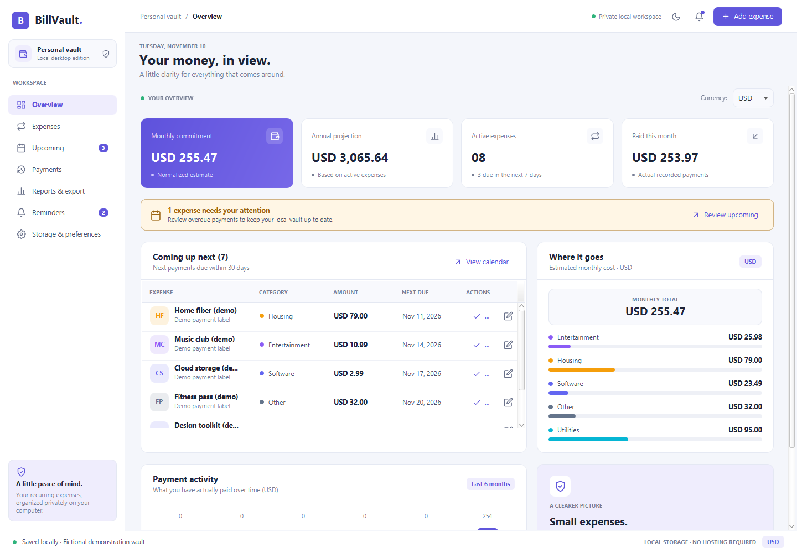
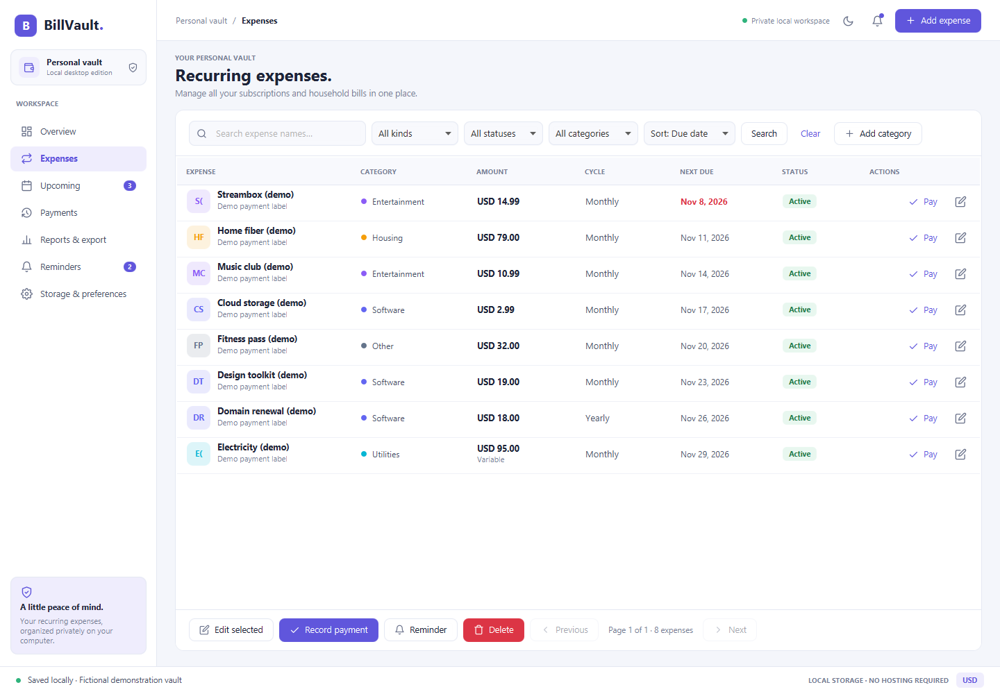
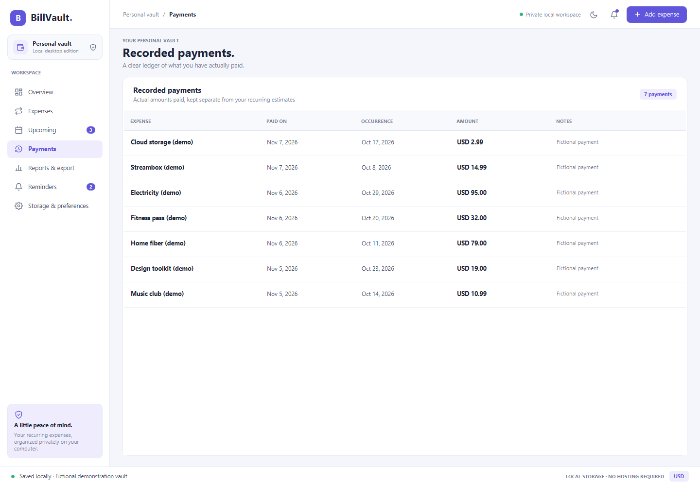
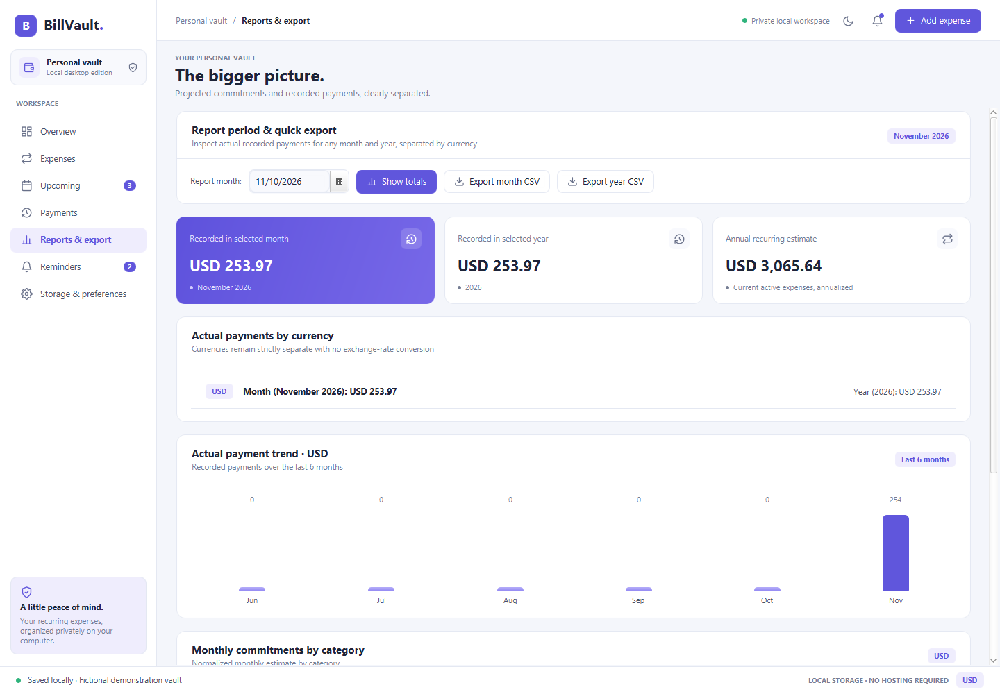
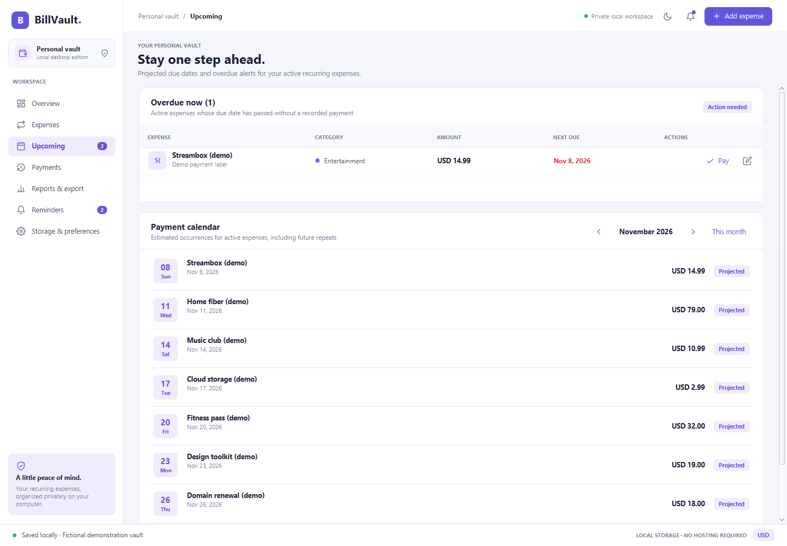
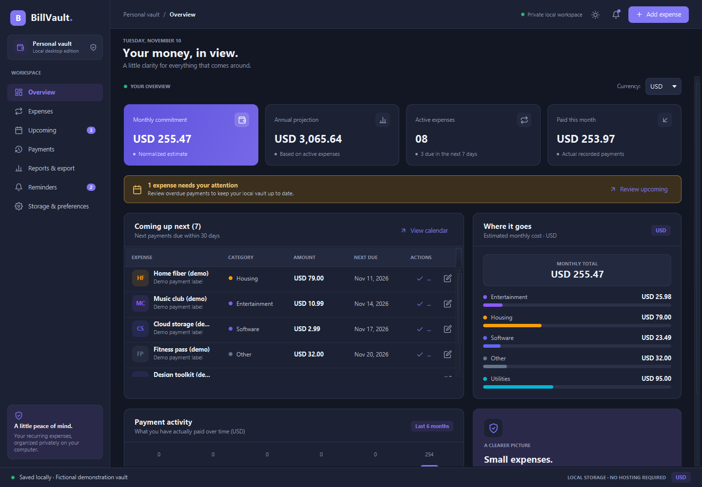

# BillVault Desktop



A native JavaFX edition of BillVault. Runs entirely on your computer with an embedded H2 database. No hosting, Docker, browser, separate Java installation, or administrator password is required for packaged downloads.

## Download and run

Use the assets under the **Desktop** release at [GitHub Releases](https://github.com/BrennenGriffith/billvault/releases). Download only packages actually listed there; source archives are not runnable desktop packages.

- **Windows x64:** download the portable ZIP, extract the entire folder, and run `BillVaultDesktop.exe`. Keep its `app` and `runtime` folders together. An `.exe` installer may also be supplied; it installs for your Windows user.
- **Linux x86_64:** download the AppImage, run `chmod +x BillVaultDesktop-*.AppImage`, then launch it. A graphical desktop with GTK 3 and compatible system libraries is required. On distributions without FUSE support, use `./BillVaultDesktop-*.AppImage --appimage-extract` and run `squashfs-root/AppRun`. The 0.3.0 package passed a packaged-app smoke test on Ubuntu 22.04 under Xvfb; other distributions have not been individually verified.
- Packages bundle the Java runtime and JavaFX. Windows downloads are unsigned; operating systems may show an unknown-publisher warning. No automatic updater is included.

Compare the download's SHA256 with its adjacent `.sha256` asset (`Get-FileHash` on Windows, `sha256sum` on Linux). Checksums detect corruption; they are not a code signature.

## What it includes

The launch window fits the display's usable area, including taskbar space, and retains native minimize, maximize, close, and resize controls. Expense toolbars wrap on narrow windows.

Seven dedicated workspaces with sidebar navigation, light/dark themes, KPI cards, category breakdowns, payment trend charts, paginated/searchable expense tables with inline Pay/Edit actions, bills/subscriptions with all recurrence fields, categories, expense editing/cancellation/deletion, payment history, actual monthly/yearly totals, CSV export, reminders refreshed while using the app, and default currency/reminder preferences. It calls the same transactional Java service layer as the web edition. Currency totals remain separate. Reminders do not run after the app closes; there are no system-tray or email notifications. The desktop appearance is separate from React's theme preferences.

## Optional assistant imports

[Connect Codex or Claude Code using MCP](../integrations/mcp/README.md) to preview and import
recurring expenses into the running local vault. The bridge is opt-in and loopback-only;
no model-provider API key is needed. Available in Desktop 0.3.0 and later; install the separate MCP adapter described in the guide.

## Android companion (source preview)

The updated source adds **Storage & preferences → Android sync** for opt-in TLS pairing and manual
phone sync. It is separate from MCP and requires no paid server. Desktop 0.3.0 downloads predate it.
See [Android setup, pairing, and sync behavior](../android/README.md). Close the desktop and back up
its data folder before building/upgrading to the new V3 schema.

## Screenshots

The actual JavaFX interface rendered with an isolated, fictional vault. All names, amounts, and payments
are examples. A new installation starts empty; these records are not shipped with the application.



| Expenses | Payment history |
| --- | --- |
|  |  |

| Reports and quick CSV export | Upcoming payment calendar |
| --- | --- |
|  |  |

<details><summary>Dark theme</summary>



</details>

## Example workflows

### Add a monthly subscription

Open **Expenses → Add expense** and use these example values:

| Field | Example |
| --- | --- |
| Name | Streambox (demo) |
| Kind / category | SUBSCRIPTION / Entertainment |
| Amount / currency | 14.99 / USD |
| Frequency | MONTHLY |
| Start date / next due date | Your first billing date |
| Status | ACTIVE |

Save it, select its row, and choose **Record payment**. Confirm the paid amount and date. The entry appears in
**Payments** and its next due date advances once. For example, a monthly expense anchored to November 8 advances
to December 8 when that November occurrence is recorded. Recording a payment is bookkeeping; BillVault does not charge a card.

### Track a variable bill

Add `Electricity (demo)` as a **BILL**, category **Utilities**, with a monthly estimate of `95.00` USD and
**Variable amount** checked. If the actual bill is `102.40`, enter that amount in **Record payment**.
Your forecast keeps its estimate; payment history and actual-payment reports use `102.40`.

### Review and export your history

In **Reports & export**, select a date in the month you want and choose **Show totals** to see that month's
and year's recorded payments, separated by currency. Choose **From** and **To** dates and **Export CSV** to
save the matching payment ledger. A CSV export is a report; back up the database separately for full recovery.

### Keep canceled subscriptions in your history

Select the expense, choose **Edit selected**, and change **Status** to **CANCELED**. This preserves its payment
history. **Delete** permanently removes the expense and its payments, so use cancellation when retaining records matters.

## Your data and credentials

There is no desktop login or stored administrator credential. Access is protected by your operating-system account. The database and exported files are **not encrypted**. Use a private OS account and disk encryption where appropriate.

- Windows: `%LOCALAPPDATA%/BillVaultDesktop/billvault.mv.db`
- Linux: `${XDG_DATA_HOME:-$HOME/.local/share}/billvault-desktop/billvault.mv.db`
- macOS source builds: `~/Library/Application Support/BillVaultDesktop/billvault.mv.db` (no macOS release package yet).

The web edition's database is separate. There is no automatic sync or complete cross-edition import. The desktop edition opens no HTTP port and needs no cloud credentials. Do not point it at a web database while that database is running. Only one desktop process may open a vault at a time.

## Back up, restore, and update

Close all BillVault Desktop windows and wait for the process to exit, then copy `billvault.mv.db` to a safe location outside the repository and preferably another device. A backup contains your financial records. Test restoration using a separate directory and `BillVaultDesktop.exe --data-dir=C:/path/to/restored-copy` (or the equivalent Linux executable argument). Never overwrite your current file without preserving a copy first.

To update, back up first, close the app, and replace the application folder/install the new version. Data stays in the OS data directory. Flyway applies migrations on startup. Older versions may not open a newer schema; keep the pre-update backup. Uninstalling the application does not automatically remove your data.

## Build from source

The repository root contains the shared Maven project. Build with the `desktop` profile and use an isolated `--data-dir` for testing.

Install a redistributable JDK 25+ (such as Eclipse Temurin) and use the Maven wrapper. The desktop profile needs no Node.js or React build; it uses native controls and does not bundle the web frontend. It runs shared billing/API tests plus desktop persistence tests, excluding the web frontend serving test. For a full web-edition verification, follow the root README separately.

```powershell
.\scripts\build-desktop.ps1 -Version 0.3.0
# Optional installer: requires a WiX toolset supported by your JDK
.\scripts\build-desktop.ps1 -Version 0.3.0 -Installer
```

For Linux, use a Linux x86_64 build machine with JDK 25+, GTK 3, packaging tools, and a verified [appimagetool](https://github.com/AppImage/appimagetool):

```sh
chmod +x mvnw scripts/build-desktop-linux.sh
APPIMAGETOOL=/absolute/path/to/appimagetool ./scripts/build-desktop-linux.sh 0.3.0
```

Build packages on their target OS. Windows jpackage cannot produce a Linux runtime. Output is under `target/desktop-release/`, excluded from Git. The [Linux desktop release workflow](https://github.com/BrennenGriffith/billvault/actions/workflows/desktop-release.yml) is active in this repository; `docs/ci/desktop-release.yml` is the matching template for forks. It checks out the existing desktop release tag and adds an AppImage only after tests and a packaged-app smoke test pass. Never package databases, backups, `.env`, or credentials as application resources.

## Desktop architecture

The desktop icon source is [packaging/billvault.svg](packaging/billvault.svg). Packaging uses a 512-pixel PNG
for Linux and a multi-resolution ICO for Windows. The JavaFX window loads the same design from its bundled resources.

`DesktopLauncher` → JavaFX `DesktopApplication` → non-web `DesktopStore` → shared `SubscriptionService` → repositories/H2. UI storage work runs on one worker thread; JavaFX changes run on its application thread. Request records are validated before writes, and the shared service retains recurrence, transaction, duplicate-payment, and stale-edit protection. The process lock prevents two desktop windows from writing the same vault.

Source and project artwork are MIT licensed. Java, JavaFX, and dependencies retain their own licenses; package notices accompany releases. This is a first desktop release, not full visual parity with the web app.
